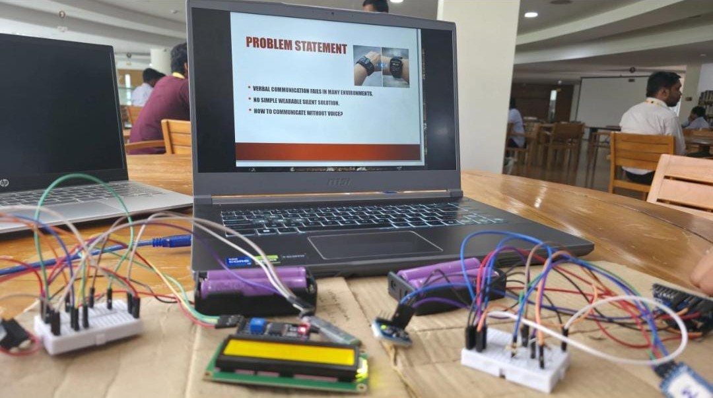

# Dual-Device Wearable System for Silent Morse-Based Communication with Health-Aware Emergency Response

A two-device wearable system that lets users communicate silently through wrist gestures encoded as Morse code, with machine-learning error correction at the receiver and automatic SOS alerts triggered by abnormal health readings.

   

> Research paper from the Department of Electronics and Communication Engineering, Mohan Babu University, Tirupati (IECOM 2026).

<p align="center">
  
  <br>
  <em>Working prototype: Arduino-based setup with MPU6050 IMU, Bluetooth module and LCD display</em>
</p>

## Problem

Speech and visual cues fail in high-noise settings such as construction sites, industrial plants and disaster zones, and for people with speech or hearing impairments. Existing gesture systems depend on fixed gesture sets, and existing Morse systems depend on manual buttons that do not suit wearables.

## Solution

| Device | Role |
|---|---|
| **TX wristband** | Reads wrist tilt with an IMU, encodes Morse, monitors heart rate and SpO2, and sends data and SOS alerts over BLE |
| **RX smartwatch** | Receives packets, corrects timing errors with an on-device ML model, displays text, and alerts through haptics or a buzzer |

### Gesture encoding

- Right tilt = dot, left tilt = dash
- IMU sampled at about 50 Hz, with a 100 ms debounce after each gesture
- Dot: 150-400 ms, dash: 400-900 ms (user-adjustable)
- A pause longer than ~600 ms ends a character, and longer than ~1200 ms ends a word

### Key features

- Silent, button-free Morse input
- BLE link with the TX unit as peripheral and the RX unit as central, packets every 50-100 ms
- ML-based error correction for timing variation, designed for deployment with TensorFlow Lite for Microcontrollers
- Automatic SOS on abnormal vitals
- Wear detection that switches between vibration and audible alerts
- Message storage on SPI flash

## System Architecture

```
TX wristband                                          RX smartwatch
User gesture -> MPU6050 IMU -> nRF52840 MCU  <-- BLE -->  nRF52840 MCU + ML -> Display
MAX30102 (heart rate, SpO2) --------^                      Vibration motor, buzzer
                                                            SPI flash (message storage)
```

## Hardware (proposed design)

nRF52840 (x2), MPU6050 IMU, MAX30102 pulse oximeter, TFT/OLED display, W25Q32 SPI flash, vibration motors, buzzer, Li-Po batteries with TP4056 charging, 3.3 V LDO regulator, capacitive wear sensors, push button, and custom SMT PCBs.

## Prototype and Results

A functional prototype built with an Arduino board, MPU6050, a Bluetooth module and an LCD (shown above) validated the end-to-end flow.

- Dot and dash tilts were detected reliably; false triggers from unintentional movement were handled with thresholding and timing limits
- Observed timing: dot ~200 ms, dash ~600 ms, character gap 600-800 ms, word gap 1200-1500 ms
- TX-to-RX delay measured at 100-300 ms
- SOS generation was demonstrated using simulated abnormal parameters
- A simple ML error-correction module was implemented at the receiver

The nRF52840 PCB design is proposed. The validated build is the Arduino prototype.

## Limitations

- Health monitoring was simulated, not validated on real physiological data
- No quantitative accuracy figure is reported for the ML error correction
- The nRF52840-based hardware has not been built and tested

## Future Work

- Build and field-test the nRF52840 PCB version
- Quantify the ML correction module's accuracy
- Validate health monitoring with real sensor data

## Authors

Mounika Konduru, Sai Sharmila Kasireddy, Payyavula Madhuri, Tejaswi Bayyapureddigari
Department of ECE, Mohan Babu University, Tirupati, Andhra Pradesh
